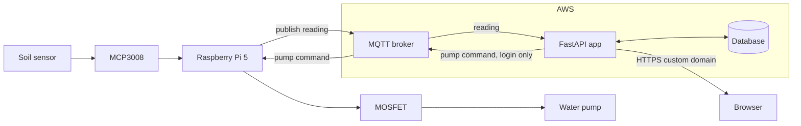

# System Architecture

Only the FastAPI app is working so far, using simulated readings.
The rest is planned.



Text version:

```
Soil sensor -> MCP3008 -> Raspberry Pi 5 -> MOSFET -> Pump
                               |  ^
                    reading    |  |  pump command
                               v  |
              AWS:  MQTT broker <-> FastAPI app <-> Database
                                        |
                                 HTTPS custom domain
                                        v
                                     Browser
```

| Part | Job | Status |
|---|---|---|
| Sensor and MCP3008 | Measure soil moisture | Planned (`sensor.py`, not tested) |
| MOSFET and pump | Water the plant | Planned (`pump.py`, not tested) |
| MQTT broker | Send messages between the Pi and the app | Planned (`mqtt_client.py`, not tested) |
| FastAPI app | API and dashboard | Working with simulated data |
| Database | Store readings | Planned |
| AWS and HTTPS domain | Host the app online | Planned |

The pump will only be controllable after a login is added.
