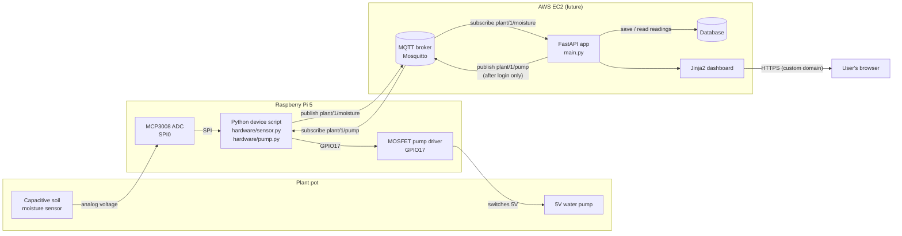

# System Architecture

This shows how the parts of the Smart Plant Monitor will fit together.
**Week 5 status:** only the FastAPI app and dashboard are running, using
simulated readings. Everything else is planned.

## Diagram



Text version (in case Mermaid does not render):

```
 [Soil sensor] --analog--> [MCP3008] --SPI--> [Raspberry Pi 5 Python script] --GPIO17--> [MOSFET] --> [Pump]
                                                       |      ^
                                    publish moisture   |      |  pump command
                                                       v      |
                                               [ MQTT broker (Mosquitto) ]
                                                       |      ^
                                  subscribe moisture   |      |  publish pump command (login required)
                                                       v      |
                                             [ FastAPI app ] <----> [ Database ]
                                                       |
                                           HTTPS (custom domain on AWS)
                                                       v
                                                [ User's browser ]
```

## Components

| Part | Job | Week 5 status |
|---|---|---|
| Soil moisture sensor + MCP3008 | Measure soil moisture (the Pi 5 has no analog inputs, so the MCP3008 converts the voltage to a number) | Planned, code stub in `hardware/sensor.py` |
| Pump + MOSFET driver | Water the plant when it is dry | Planned, code stub in `hardware/pump.py` |
| MQTT broker | Pass messages between the Pi and the server (publish/subscribe) | Planned, code stub in `mqtt_client.py` |
| FastAPI app | Receives readings, decides plant status, serves the API and dashboard | **Running (simulated data)** |
| Database | Stores reading history | Planned (readings are kept in memory for now) |
| AWS + HTTPS domain | Host the app online securely | Planned |

## MQTT topics

| Topic | Published by | Subscribed by | Example message |
|---|---|---|---|
| `plant/1/moisture` | Raspberry Pi | FastAPI app | `{"raw_value": 540, "moisture_percent": 57.8, "timestamp": "...", "simulated": false}` |
| `plant/1/pump` | FastAPI app (logged-in user only) | Raspberry Pi | `{"action": "on", "seconds": 3}` |

## Security decisions

- No passwords or keys in the code. They come from environment variables (`.env`, which Git ignores).
- There is **no** web endpoint that controls the pump yet. It will only be added together with user login.
- The pump code has a maximum run time, so it cannot run forever.
- On AWS, the MQTT broker will need a username and password (and TLS), not anonymous access.
